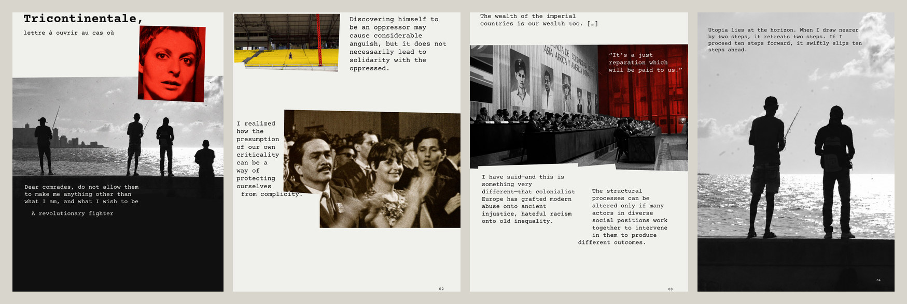
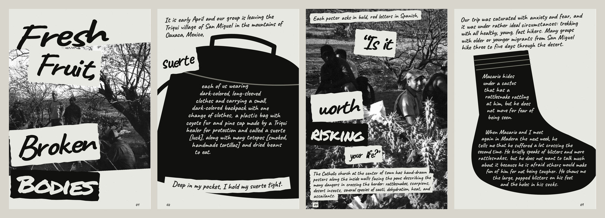

# Zine Skills

**把电影与民族志读成一本小志。** 两套从真实原文、图像与阅读出发的 Codex skills。

**Turn films and ethnographies into zines.** Two Codex skills for source-led editing, collage layouts and finished page exports.

[看成品 · Showcase](#成品展示--finished-zines) · [安装 · Install](#安装--install) · [使用示例 · Try it](#开始制作--try-it) · [下载 · Downloads](https://github.com/yuanztapply/zine-skills/releases/latest)

## 成品展示 / Finished zines

下面两本均为已经完成的项目。图片是成品的网页预览；点击可查看完整页序。每部新作品的视觉方向由它的材料决定。

### Film — *Tricontinentale, lettre à ouvrir au cas où*

[](docs/showcase/film/README.md)

四页电影小志。核实的电影与学术原句、打字机字体、真实剧照和局部色彩处理相互编织，文字进入图像的缺口与暗部。

*A four-page film zine pairing verified film and scholarly excerpts with typewritten typography, authentic stills and selective colour treatments.*

[看完整 4 页 →](docs/showcase/film/README.md) · [查看 film-zine 技能](film-zine/SKILL.md)

### Ethnography — *Fresh Fruit, Broken Bodies*, Contour edition

[](docs/showcase/ethnography/README.md)

十二页黑白民族志小志，选用 Seth M. Holmes 原著导论的英文原文，让文字沿物件轮廓排布，将照片、剪贴与阅读连在一起。

*A twelve-page monochrome zine using selected English passages from Seth M. Holmes’s introduction, with text flowing around objects and photographs.*

[看完整 12 页 →](docs/showcase/ethnography/README.md) · [查看 ethnography-zine 技能](ethnography-zine/SKILL.md)

两本示例的阅读范围、素材出处及图像处理见 [展示来源说明](docs/showcase/SOURCES.md)。

## 两套技能 / Choose a skill

| 技能 | 从什么开始 | 主要工作 | 默认输出 |
| --- | --- | --- | --- |
| [`film-zine`](film-zine/SKILL.md) | 片名、年份、导演或电影链接 | 核实原句与真实剧照；选文、图文编排与逐页检查 | 逐页 PNG；按需裁边与图片 ZIP |
| [`ethnography-zine`](ethnography-zine/SKILL.md) | 原著 PDF、正文或可访问材料 | 阅读、原文选编、编辑主线、轮廓排字与剪贴版式 | PDF、可编辑文件与预览；按需导出图片 |

两套技能都保留来源记录，区分作者、人物与编辑声音；当次明确要求优先于默认偏好。字体、颜色、页数随作品调整。

## 安装 / Install

### 在 Codex 中直接安装 / Ask Codex to install

将下面这段粘贴到 Codex：

```text
$skill-installer 请从 https://github.com/yuanztapply/zine-skills 安装 film-zine 和 ethnography-zine 两个技能。
```

English:

```text
$skill-installer Install film-zine and ethnography-zine from https://github.com/yuanztapply/zine-skills.
```

Codex 会识别新安装的技能；如果未显示，重新启动 Codex。也可下载 [最新技能包](https://github.com/yuanztapply/zine-skills/releases/latest)，按 [手动安装说明](INSTALL.md) 复制文件夹。

安装方式依据 [OpenAI 官方技能文档](https://learn.chatgpt.com/docs/build-skills)。这些 skills 在 Codex 内执行制作流程；具体任务需要可用的检索、文件与排版工具。

## 开始制作 / Try it

### 电影小志

```text
$film-zine 用《影片正式片名》（年份，导演）制作一本电影小志。
我想关注的主题是：……
请核实原句与真实剧照，保留原文语言，交付逐页 PNG。
```

### 民族志小志

```text
$ethnography-zine 请用我附上的民族志 PDF 制作一本小志。
阅读范围：导论 / 指定章节。
我关心的问题是：……
保留英文原文，让文字与照片、物件轮廓交织；交付 PDF、可编辑文件和图片预览。
```

**Helpful inputs:** a film title with its year and director, or an ethnographic text; a question you care about; your preferred language and output format. The skills handle selection, layout and checks from there.

## 辅助脚本 / Export tools

需要运行辅助脚本时，使用 Python 3.10+ 并安装依赖：

```sh
python -m pip install -r requirements.txt
```

PDF 转图片另需系统安装 Poppler，并让 `pdftoppm` 可用。macOS 可通过 Homebrew 安装 `poppler`；Linux 可安装 `poppler-utils`。

```sh
python film-zine/scripts/extract_palette.py --help
python film-zine/scripts/export_pages.py --help
python ethnography-zine/scripts/export_images.py --help
```

`ethnography-zine/assets/contour_engine.js` 使用浏览器原生功能，无额外 JavaScript 包依赖。

## 分享与反馈 / Share & contribute

用过后欢迎在 [Issues](https://github.com/yuanztapply/zine-skills/issues) 分享成品链接、遇到的问题或改进建议。报告问题时附上所用技能、输入材料范围、预期输出与实际结果；请省略私人材料和凭据。

如果这些流程对你有帮助，欢迎 Star，方便下次找到；分享时可以直接使用本仓库链接。

## 素材说明 / Source materials

新项目所用的原著、剧照、海报和字体由具体任务提供或从合适来源取得。展示页注明原作归属与处理情况；示例中的第三方文本和照片权利归各自权利人。仓库中的技能文件、示例图与第三方素材应分别理解，公开展示不代表第三方素材已获额外授权。
