# Fresh Fruit, Broken Bodies — Contour edition

已完成的十二页黑白民族志小志。选用 Seth M. Holmes 原著导论的英文原文，让文字沿背包、玉米与袜子等物件轮廓排布，将照片、剪贴与阅读连在一起。

*A completed twelve-page monochrome ethnography zine, using selected English passages from the introduction to Seth M. Holmes’s Fresh Fruit, Broken Bodies. Text follows object contours, bringing photographs, collage and reading together.*

以下为 A5 定稿成品的网页预览，按阅读顺序排列；仅等比例缩小与 JPEG 压缩，未重做版面或删改内容。它是选段编辑与设计案例，不是完整原著。

[返回仓库首页](../../../README.md) · [素材与版本说明](../SOURCES.md)

## 第 1 页 / Page 1

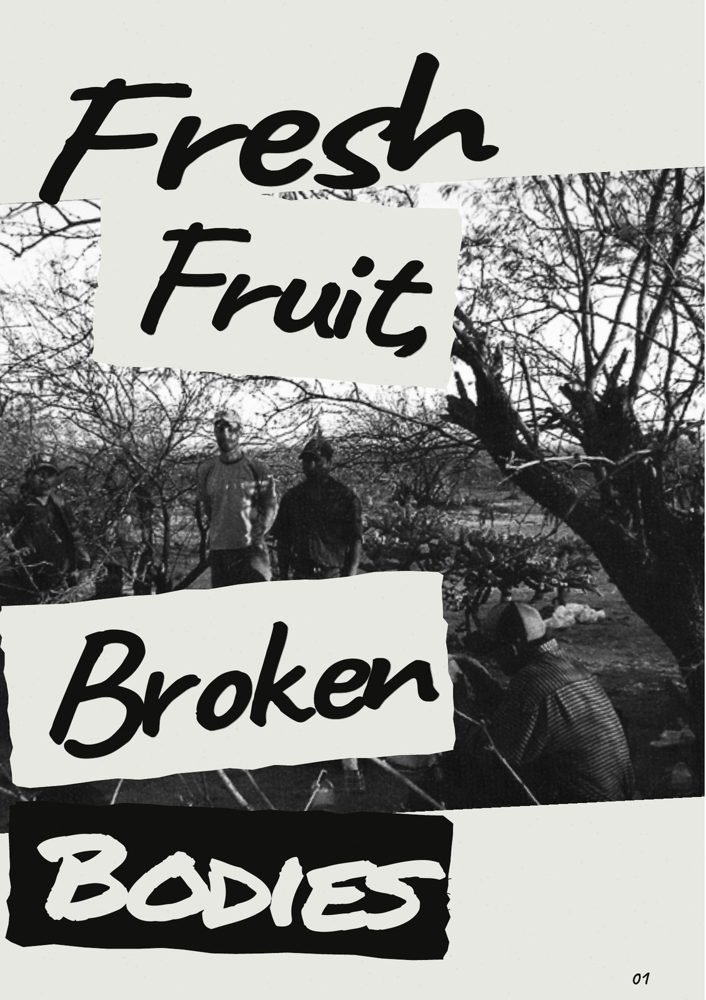

## 第 2 页 / Page 2

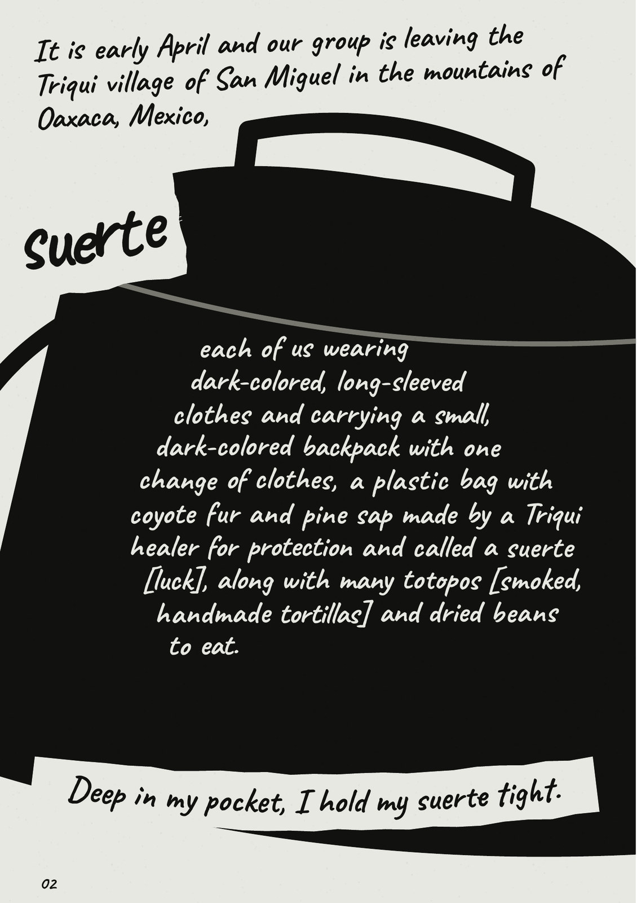

## 第 3 页 / Page 3

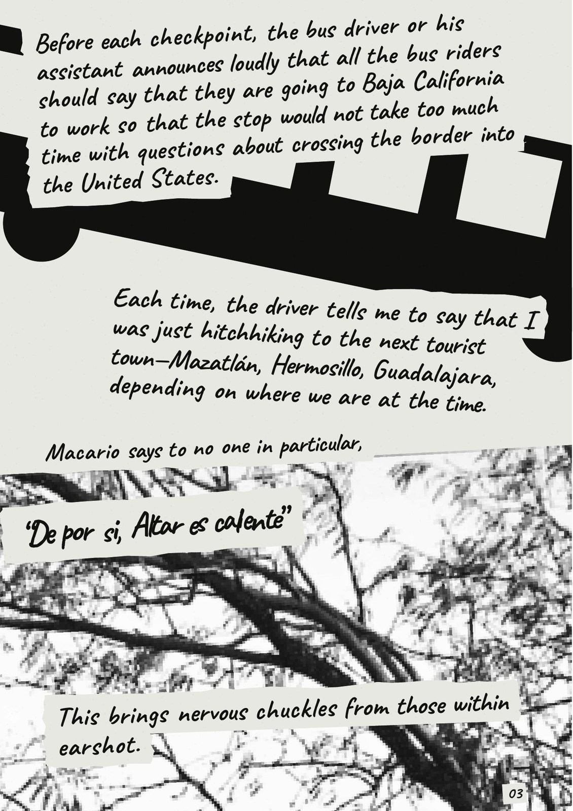

## 第 4 页 / Page 4

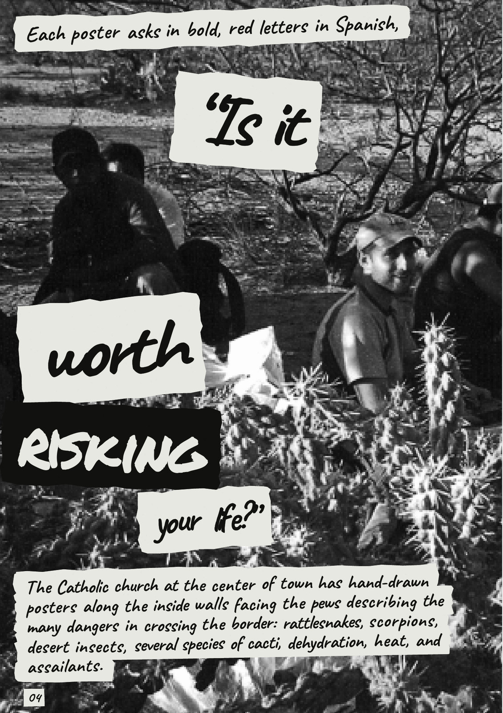

## 第 5 页 / Page 5

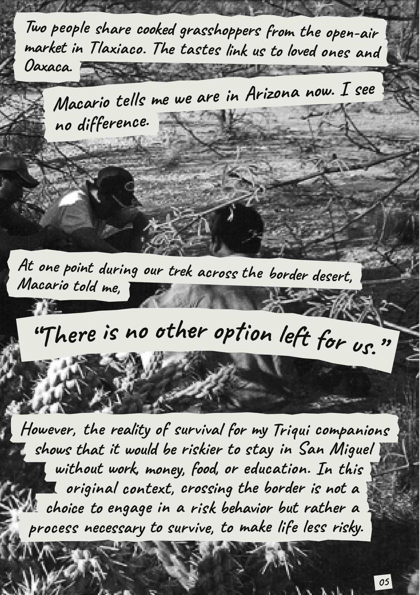

## 第 6 页 / Page 6

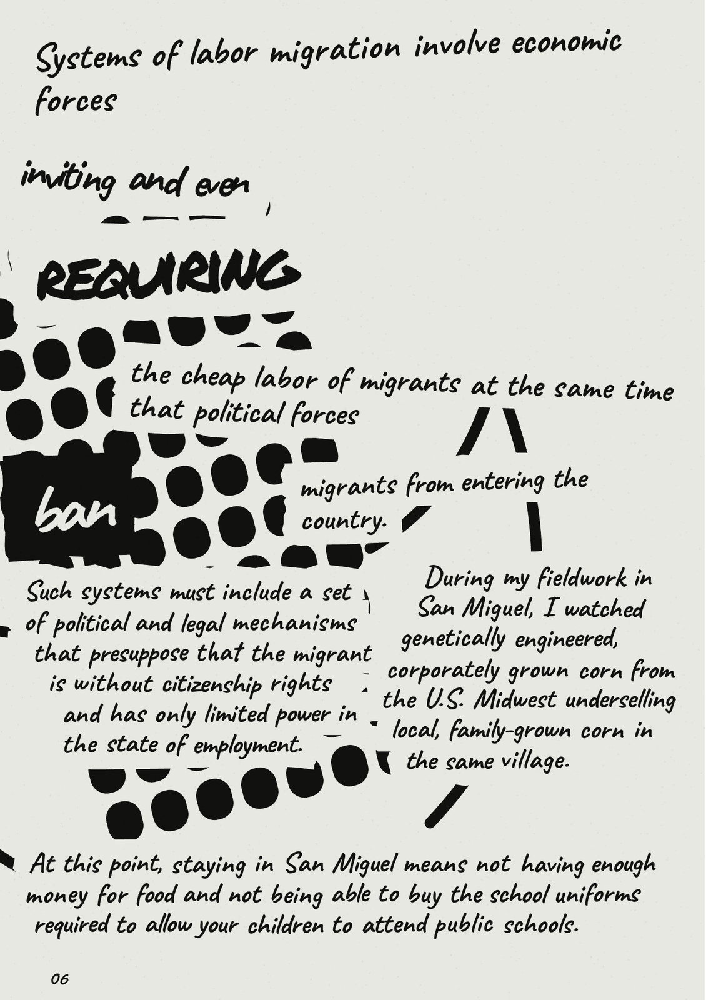

## 第 7 页 / Page 7

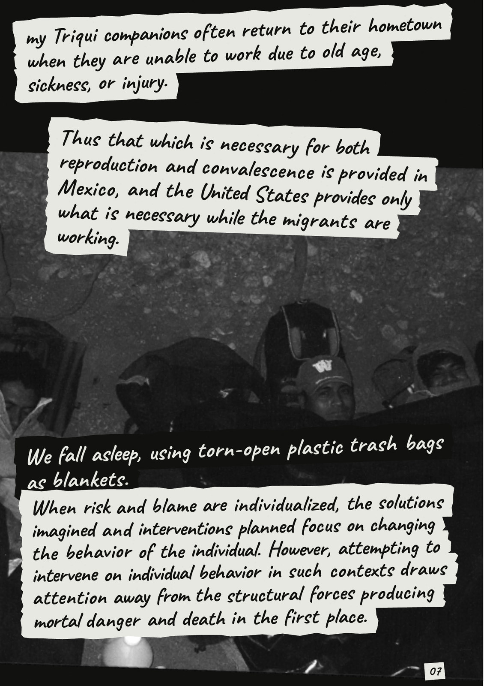

## 第 8 页 / Page 8

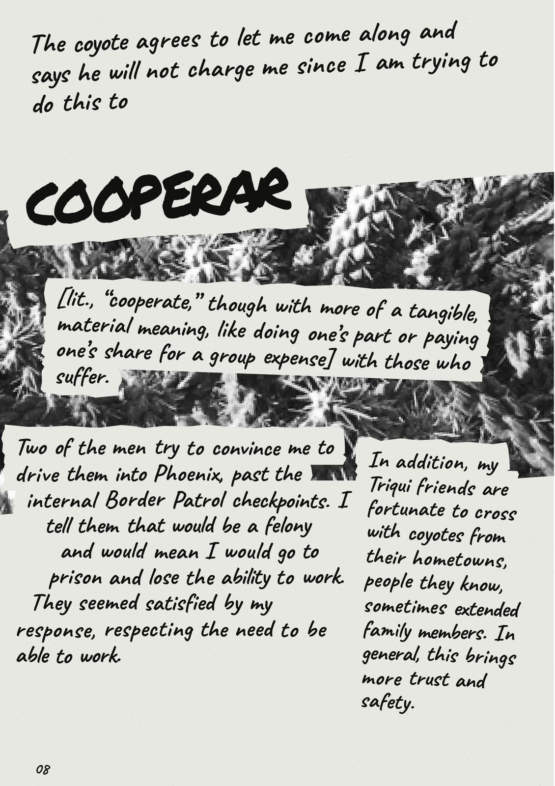

## 第 9 页 / Page 9

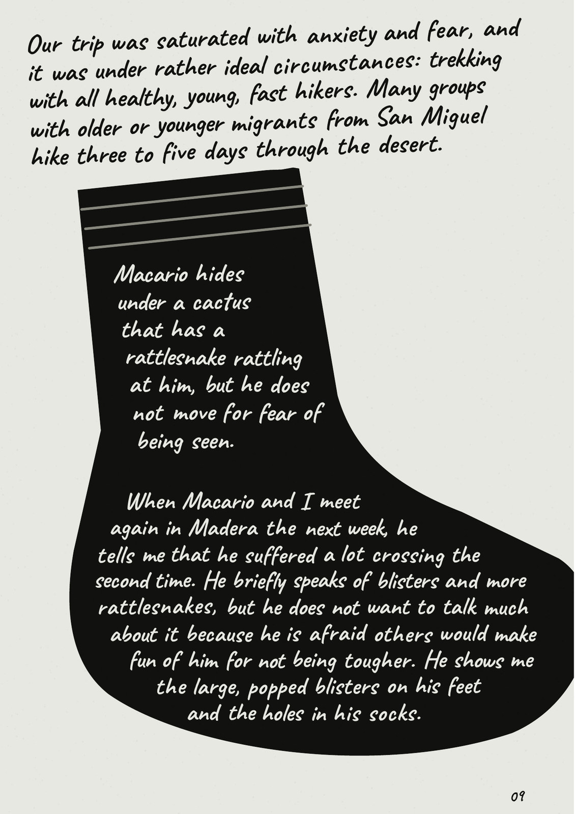

## 第 10 页 / Page 10

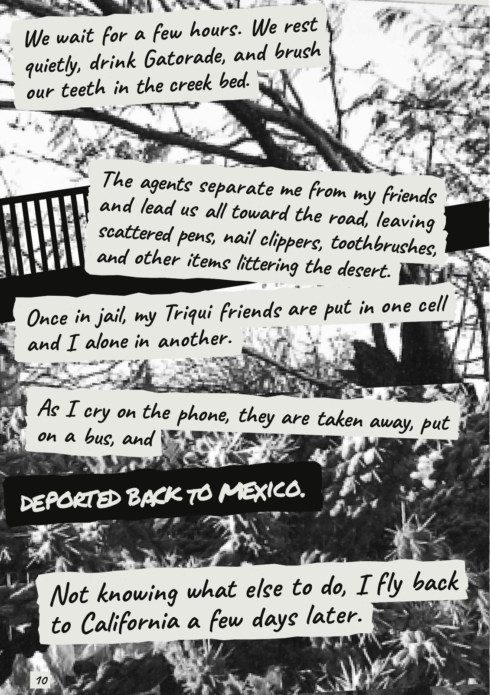

## 第 11 页 / Page 11

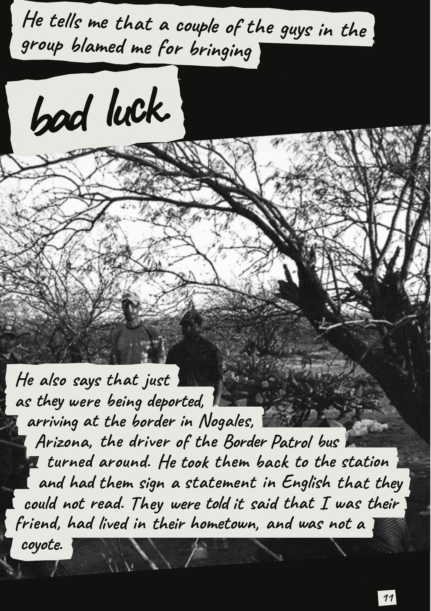

## 第 12 页 / Page 12

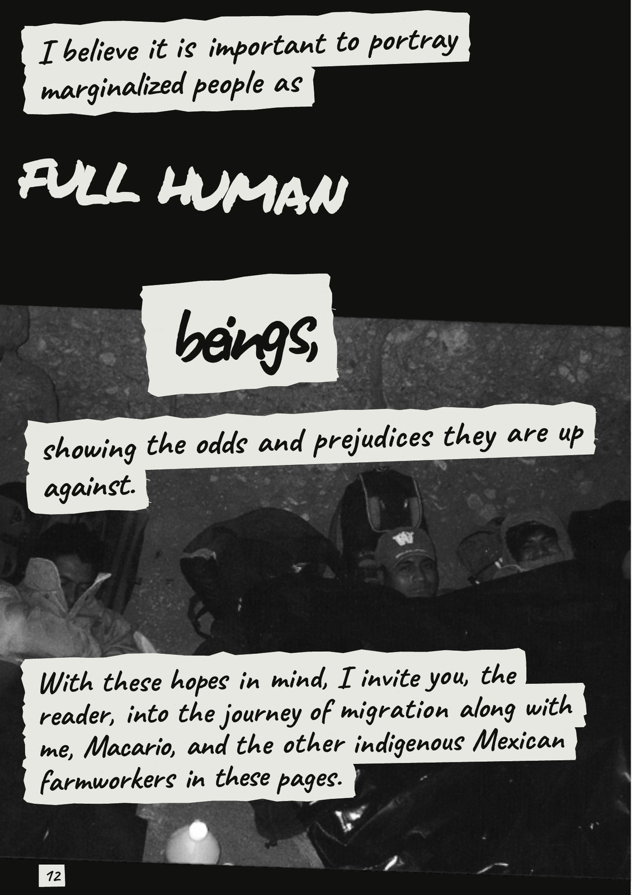
