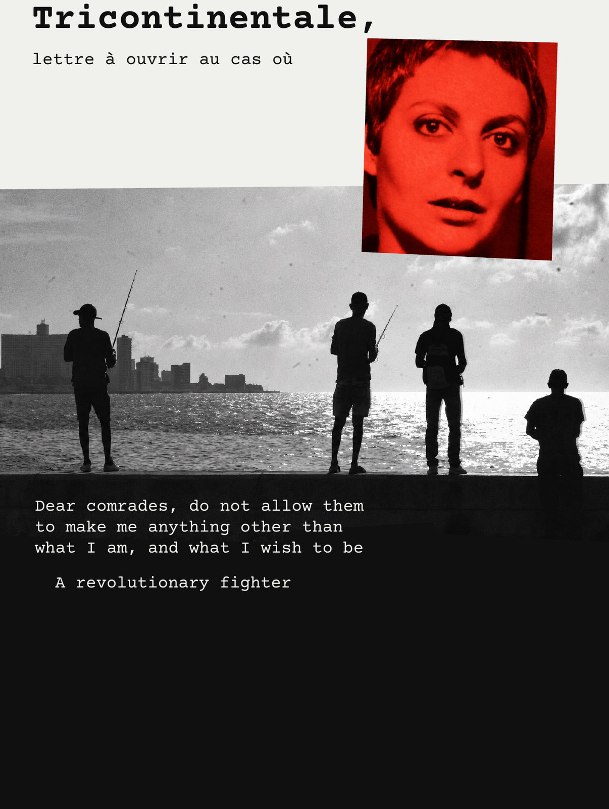
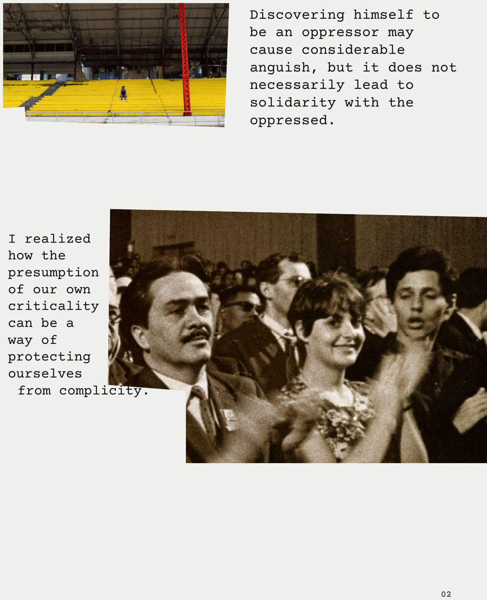
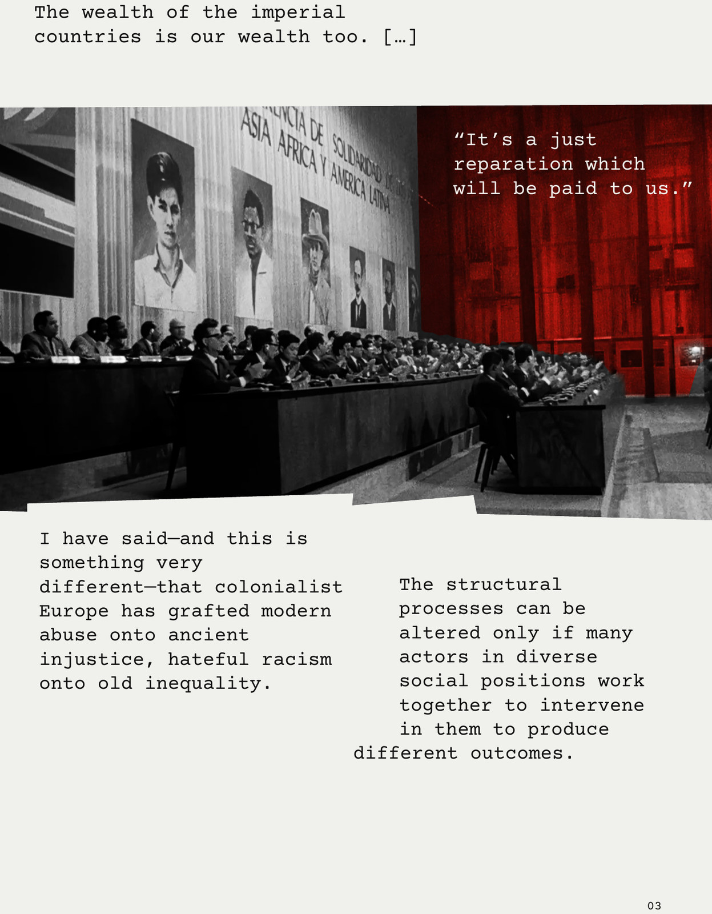
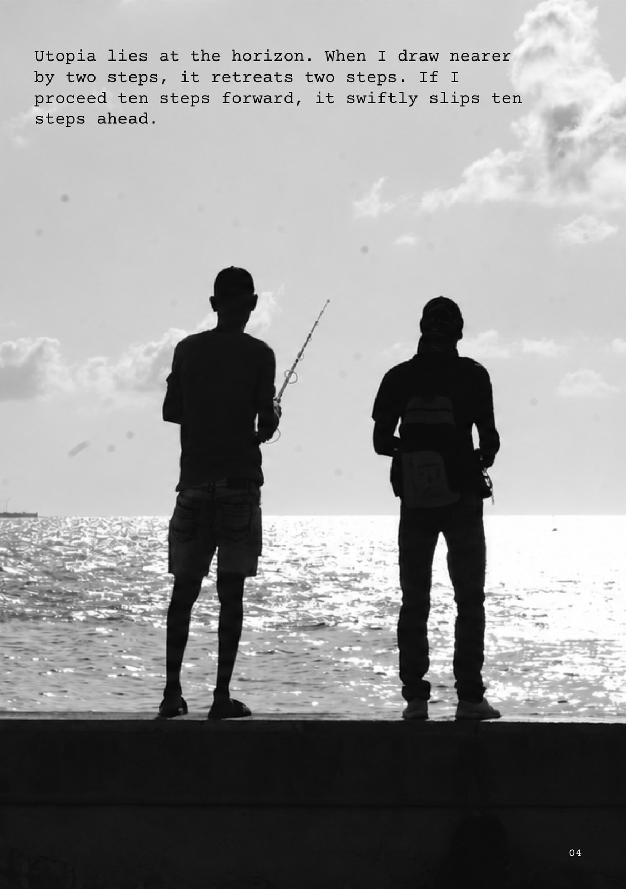

# Tricontinentale, lettre à ouvrir au cas où

已完成的四页电影小志。以核实的电影与学术原句组织阅读，结合打字机字体、真实剧照和局部色彩处理，让文字进入图像的缺口与暗部。

*A completed four-page film zine, combining verified film and scholarly excerpts with typewritten typography, authentic stills and selective colour treatments.*

以下为定稿成品的网页预览，按阅读顺序排列；仅等比例缩小与 JPEG 压缩，未重做版面或删改内容。原成品已裁去外围白边，各页比例略有不同。

[返回仓库首页](../../../README.md) · [素材与版本说明](../SOURCES.md)

## 第 1 页 / Page 1

## 第 2 页 / Page 2

## 第 3 页 / Page 3

## 第 4 页 / Page 4

